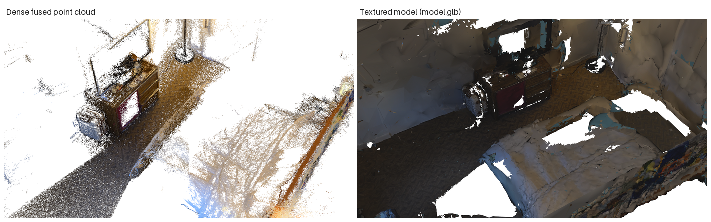
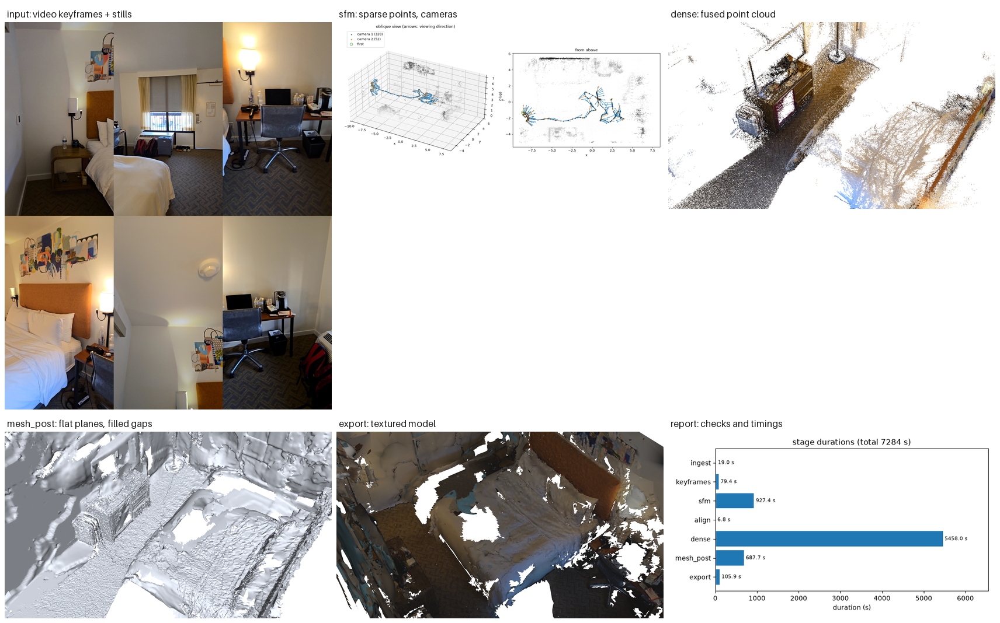
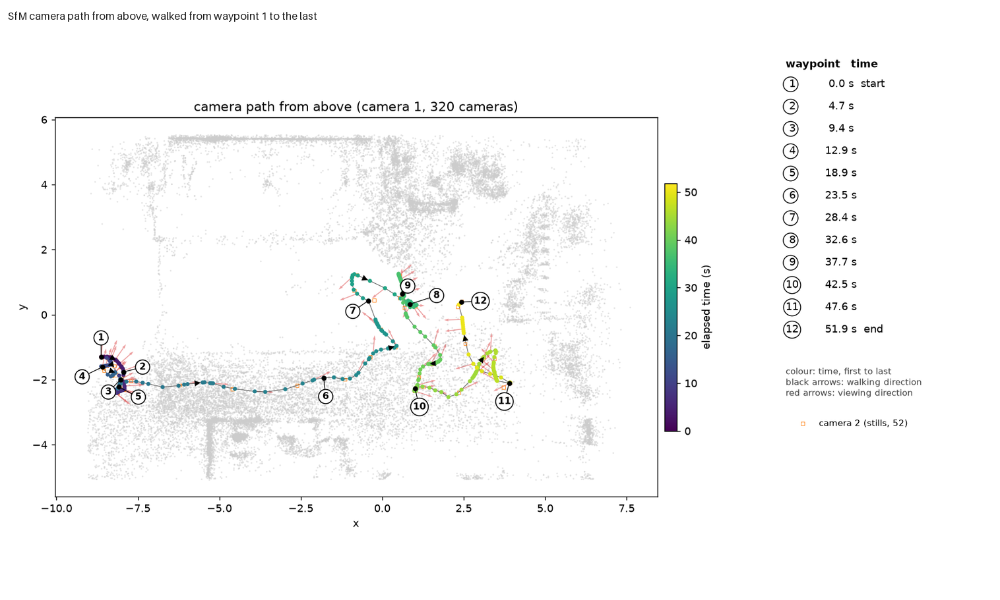
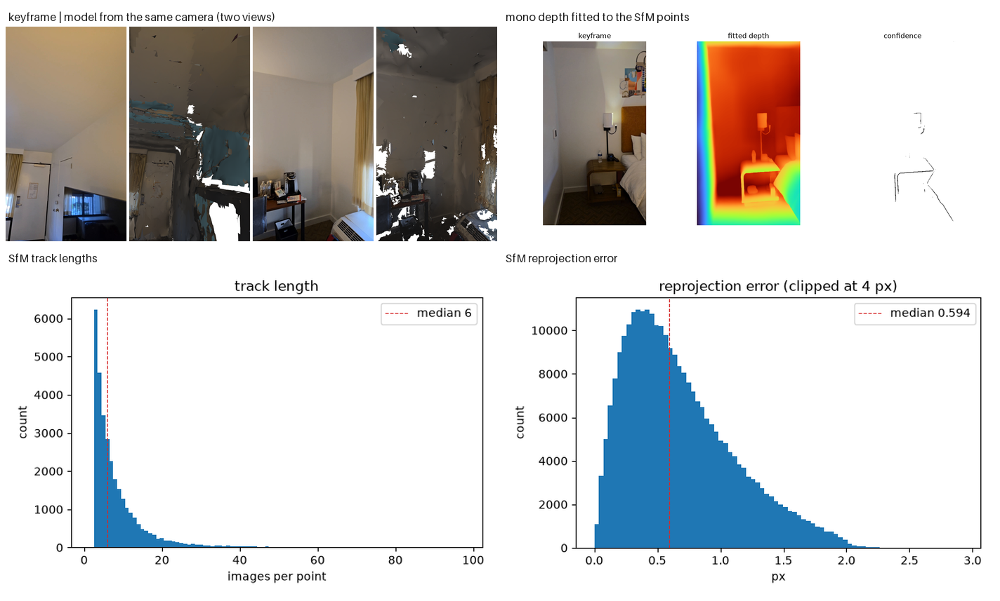
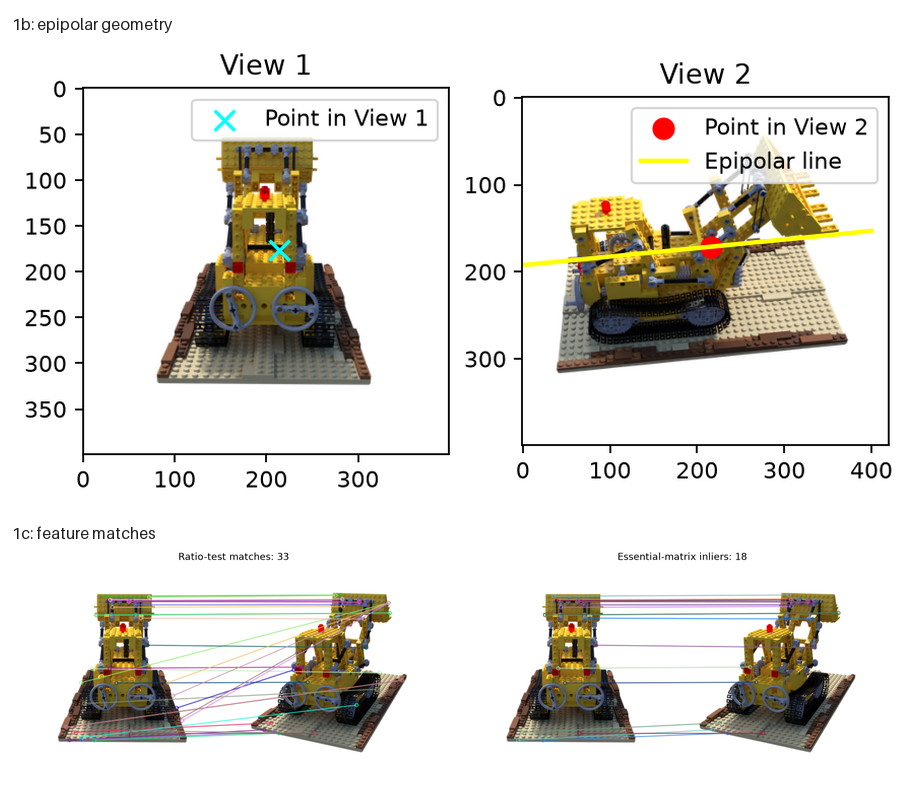

# 3D room reconstruction

Turns a phone video with IMU data (Open Camera Sensors capture) into a textured, plane-regularized room mesh. SfM with COLMAP/GLOMAP, dense reconstruction and texturing with OpenMVS (CUDA), monocular-depth gap filling, and an HTML quality report.



The example capture `data/hotel1` (a hotel room: one 3146-frame phone video, 53 sharper reference stills and the IMU streams) ships in Git LFS; the results below are from it. The figures are rendered from the run's outputs by the report stage for every dataset (`08_report/figures/`); `scripts/make_readme_figures.py --run <run dir>` copies them to `results/`.

## Setup

Linux x86_64, NVIDIA GPU with a CUDA 12.9+ driver (developed on a GTX 1660 Ti), `git`, `git-lfs`.

```bash
wget -qO- https://pixi.sh/install.sh | sh                       # 1. pixi, then restart the shell
git lfs install                                                 # 2. once (sudo apt install git-lfs)
git clone --recurse-submodules https://github.com/aby03/3d-reconstruction.git && cd 3d-reconstruction
pixi install                                                    # 3. main environment
pixi install -e build && pixi run -e build openmvs              # 4. OpenMVS (develop) with CUDA (minutes, once)
pixi run recon doctor                                           # 5. GPU, CUDA paths, tool versions
```

Already cloned without submodules or LFS: `git submodule update --init --recursive`, `git lfs pull`. Step 4 builds two small dependencies from source (`halfmesh`, `tinyply`), applies `patches/openmvs-no-sfm.patch` (skips OpenMVS's own SfM library and its two apps, which we do not use and which need packages conda-forge lacks) and builds the `develop` branch of OpenMVS: it contains the TextureMesh fix for `--resolution-level` above 0 that made the 2.1 build hang.

## Run

```bash
pixi run recon run --input data/hotel1                 # every stage
pixi run recon run --input data/hotel1 --to keyframes  # stop after a stage
pixi run recon run --input data/hotel1 --resume        # continue the latest run, skipping up-to-date stages
pixi run recon compare RUN_A RUN_B --scene hotel1      # metrics of two runs side by side
pixi run recon list-stages
```

Per-sequence stages write to `outputs/<scene>/sequences/<id>/<NN_stage>/`, scene stages to `outputs/<scene>/runs/<run_id>/<NN_stage>/`. A stage whose inputs and config are unchanged is skipped.

| Option | Meaning |
|---|---|
| `--from/--to/--only STAGE` | choose the stages to run |
| `--force STAGE` | re-run a stage and everything after it |
| `--resume [RUN_ID]` | continue in a run dir (no id: the latest) |
| `--set KEY=VALUE` | override a config key, e.g. `--set keyframes.stills=false` |
| `--config FILE` | YAML layered over `configs/default.yaml` |
| `--hardware PRESET` | `cuda_6gb`, `cuda_large`, `cpu` (default: picked by GPU memory) |

`configs/default.yaml` lists every key with its default; unknown keys are errors.

## Pipeline

| # | Stage | What it does | Main outputs |
|---|---|---|---|
| 1 | `ingest` | loads video, timestamps and IMU, checks frame timing, syncs sensors to frames, estimates gravity | `frames.csv`, sync report |
| 2 | `keyframes` | scores blur/exposure/motion, picks keyframes (adaptive to image motion and gyro); adds the reference stills as camera `cam1` | `images/cam0`, `images/cam1`, IMU priors |
| 3 | `sfm` | SIFT features, time-neighbour and loop matching, COLMAP global mapper with gravity priors and a drift-aware gyro pair filter, then refinement; checks that the camera path is continuous in time (jumps, isolated cameras, gyro and accelerometer windows, magnetometer) and re-maps with the incremental mapper when the path comes out in pieces | `sparse/refined`, `sfm_report.json` |
| 4 | `align` | world frame: Z up, floor at z = 0, X/Y along the walls; checks camera–IMU calibration | `sparse_aligned`, `transform.json` |
| 5 | `dense` | undistort, OpenMVS densify (fusion filter 1), mesh and refine, outlier filter, Depth-Anything-V2 mono depth fitted to the mesh depth, TSDF fusion | `dense_points.ply`, `mesh_refined.ply`, `mesh_tsdf.ply` |
| 6 | `mesh_post` | cleanup, gap fill from mono depth, hole closing, view-consistency check, plane snapping, decimation to 2M faces, texturing with seam leveling, texture fixes, QA | `mesh_final_geometry.ply`, `textured_fixed/` |
| 7 | `export` | GLB (Y up), OBJ, PLY, STL, point clouds, cameras (COLMAP, nerfstudio `transforms.json`), `metadata.json`; every file is reloaded and checked | `07_export/` |
| 8 | `report` | thresholds on every stage, one HTML page | `08_report/index.html` |

Each stage also runs alone (`pixi run recon <stage> --input data/hotel1`) and writes `stage_manifest.json` plus a `reports/` folder with its metrics and plots.

Design points worth knowing:

- **Stills as a second camera.** Reference stills have about 3x the sharpness of the video frames and join SfM with their own intrinsics (`keyframes.stills`).
- **Gap filling.** Textureless walls leave the dense cloud empty. Patches of the mono-depth TSDF mesh are added where the OpenMVS mesh has no surface (`mesh_post.fill.*`); an optional weld joins them to the mesh but costs accuracy, so it is off.
- **No cropping.** The whole reconstruction is kept; the optional room-extent crops (`dense.filter.roi`, `mesh_post.roi`) are off.
- **Plane regularization.** Floor, ceiling and walls are found from face normals and vertices are snapped onto them (`mesh_post.planes.*`).
- **Seam leveling** needs an OpenMVS build with the seam-leveling fix (`mesh_post.texture.seam_leveling`); the `develop` build has it, release 2.4.0 turns textures black.
- **CPU path.** Every CUDA path has a CPU fallback (`--hardware cpu` or `--set device.preference=cpu`).

## Outputs

`outputs/<scene>/runs/<run_id>/07_export/`:

- `model.glb`: textured, Y up; `model_preview.glb`: the same at 300k faces for a quick look. View it at https://gltf-viewer.donmccurdy.com (opened locally) or in Blender with Material Preview shading.
- `obj/model.obj` (Z up), `model_vertex_color.ply`, `model.stl`
- `point_clouds/{sparse,dense}.ply`, `cameras/` (COLMAP model, `transforms.json`), `metadata.json`

`08_report/figures/` holds `overview.png`, `stages.png`, `path.png` (camera path from above with numbered waypoints) and `details.png`, rendered offscreen from the run (config `report.figures`; no OpenGL window: a warning, the run still succeeds). `08_report/index.html` links them and shows the thresholds (registered ratio, reprojection error, gravity residual, untextured faces, wall RMS, dense-to-mesh p95) with pass/fail.

## Run summary and results

```bash
pixi run recon run --input data/hotel1
```

Run `20261105_093901` on a GTX 1660 Ti (6 GB), `cuda_6gb` preset. All 10 report thresholds pass.

| Stage | Time | Result |
|---|---|---|
| `ingest` | 19 s | 3146 frames, 2 dropped |
| `keyframes` | 79 s | 322 keyframes + 53 stills |
| `sfm` | 927 s | 372 of 375 images registered, 31,566 points, 0.67 px mean reprojection error |
| `align` | 7 s | gravity residual 0.96 deg (median), floor tilt 0.46 deg |
| `dense` | 5458 s | 11.6 M dense points, mesh 4.1 M faces, 2.4 M after refine |
| `mesh_post` | 688 s | 2.0 M faces, 2 texture atlases, 0 % untextured faces, wall RMS 0.02 % of the diagonal |
| `export` | 106 s | `model.glb` 149.5 MB, cameras re-project within 0.075 px |
| total | 7284 s (2.0 h) | sum of the stage times |

The stage times come from `08_report/summary.json`; the first four stages of this run were produced in earlier invocations of the same run directory (`--resume`) and `dense` finished in 91 min on the OpenMVS `develop` build (the 2.1 build needed about 2.4 times as long for densify alone). The renders below are unretouched: the mesh still has holes where nothing was seen and noisy surfaces on furniture.



Top row: input keyframes and stills, SfM sparse points with cameras, dense point cloud. Bottom row: mesh geometry after plane snapping and gap filling, the textured model, the report page.

### SfM walkthrough



The camera path of the video (camera 1, 320 cameras) seen from above, the sparse points in grey. Numbered circles mark equal time steps along the walk (the table on the right gives the elapsed seconds), black arrowheads the walking direction, thin red arrows the viewing direction of every few cameras, orange squares the stills. The walk starts at the left end of the room (waypoint 1), turns on the spot for about 19 s (waypoints 1 to 5), goes along the lower wall to the middle (6), circles through the middle of the room (7 to 9), and ends with a loop on the right (10 to 12). The path has no jumps: the global mapper cut it into pieces on this capture, so the stage re-mapped it with the incremental mapper (`sfm.mapper.retry_on_jumps`).



Left of each pair a keyframe, right the model rendered from the same camera pose (the poses line up, the holes and the blue gap-fill patches show what is still missing), then the mono depth fit, the SfM track lengths and the SfM reprojection error.

## Tests

```bash
pixi run test    # one test file per stage, on a short test clip (scripts/make_test_clip.py)
```

## Tutorials

Small standalone scripts: `pixi run 1a_projection` (projection), `1b_epipolar` (essential/fundamental matrix, epipolar lines), `1c_two_view_geometry` (matching, relative pose, triangulation). Their plots are written to `results/tutorial_*.png`; `pixi run python scripts/make_readme_figures.py --tutorials` joins the epipolar and feature-match plots into the figure below.


