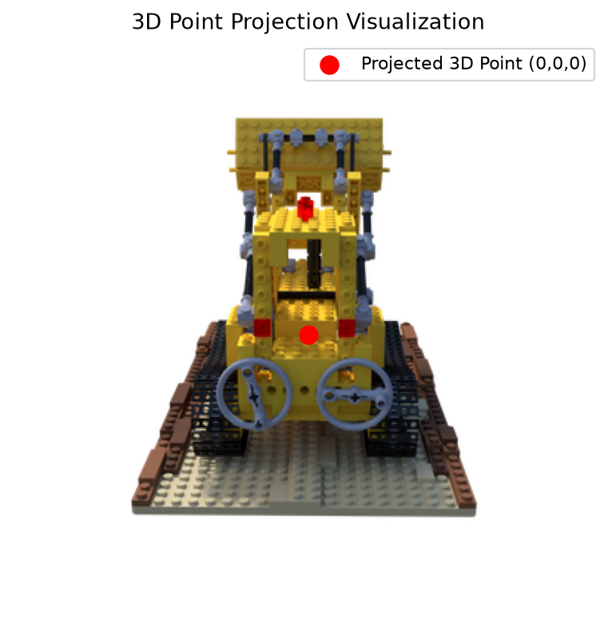
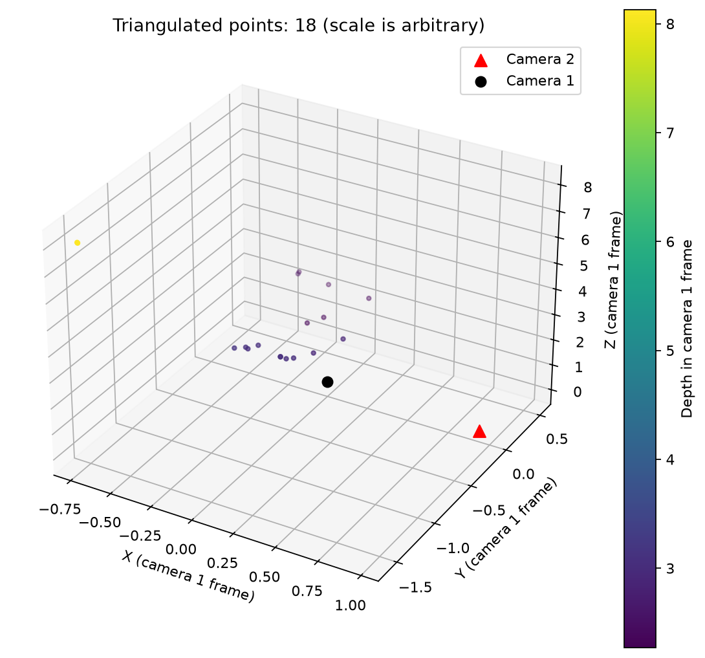

# Overview

Hands-on experiments with computer vision concepts and 3d reconstruction.

## Project Setup
1. Install pixi
```
wget -qO- https://pixi.sh/install.sh | sh
```

2. Download data
```
pixi run download-data
```

## Running code

### 1a. projection
Project 3d world coordinates to image plane given intrinsics and extrinsics
```
pixi run 1a_projection
```



### 1b. Epipolar Geometry
Covers Essential Matrix, Fundamental Matrix and Epipolar line computation given 2 views sharing world coordinates frame.
```
pixi run 1b_epipolar
```


### 1c. Multi-view Geometry
Using 2 images, compute matching points, essential matrix, relative pose, camera positions and matching points projection in 3D.
```
pixi run 1c_two_view_geometry
```




### 3. Room Reconstruction
Compare two room reconstruction pipelines. The `3a` baseline uses COLMAP for sparse-to-dense reconstruction. The `3b` pipeline samples the `room2` MP4 with OpenCV, estimates camera poses with COLMAP, and uses OpenMVS for dense reconstruction and image texturing.

```bash
pixi run 3a_reconstruction
pixi run 3b_reconstruction
```

The `3b` pipeline defaults to `data/room2` and writes timestamped runs under `outputs/room2_reconstruction/`. OpenMVS command-line tools must be installed separately and available on `PATH`. See the [reconstruction guide](src/tutorials/3_reconstruction/README.md) for details.