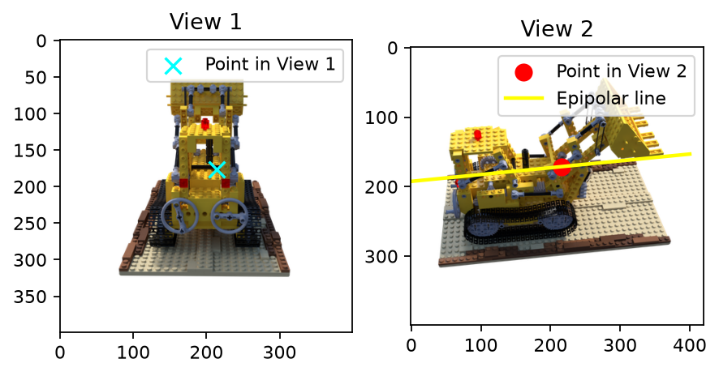

# Overview

Hands-on experiments with computer vision concepts and 3d reconstruction.

## Project Setup

First-time setup after cloning. Requires Linux x86_64, an NVIDIA GPU with a CUDA 12.9+ driver (developed on a GTX 1660 Ti, sm_75), `git` and `curl`/`wget`.

1. Install pixi
```bash
wget -qO- https://pixi.sh/install.sh | sh
```
Restart the shell, then check `pixi --version`.

2. Clone with submodules (OpenMVS and VCG live in `third_party/`)
```bash
git clone --recurse-submodules https://github.com/aby03/3d-reconstruction.git
cd 3d-reconstruction
# if you already cloned without --recurse-submodules:
git submodule update --init --recursive
```

3. Install the main environment
```bash
pixi install
```

4. Build OpenMVS with CUDA (one-off, takes several minutes)
```bash
pixi install -e build
pixi run -e build openmvs
```
Binaries are installed to `.local/openmvs/bin/OpenMVS/` and are added to `PATH` by pixi. Details and troubleshooting: [OpenMVS CUDA build](plans/architecture/openmvs_cuda_build.md).

5. Verify the OpenMVS build
```bash
pixi run DensifyPointCloud --help      # should print "--cuda-device"
pixi run -e build ldd .local/openmvs/bin/OpenMVS/DensifyPointCloud | grep -Ei 'cuda|not found'
```

6. Download data
```bash
pixi run download-data
```

## Running 3d reconstruction pipeline


## Running tutorials

### 1a. projection
Project 3d world coordinates to image plane given intrinsics and extrinsics
```
pixi run 1a_projection
```


### 1b. Epipolar Geometry
Covers Essential Matrix, Fundamental Matrix and Epipolar line computation given 2 views sharing world coordinates frame.
```
pixi run 1b_epipolar
```



### 1c. Multi-view Geometry
Using 2 images, compute matching points, essential matrix, relative pose, camera positions and matching points projection in 3D.
```
pixi run 1c_two_view_geometry
```


### 3. Room Reconstruction
Compare two room reconstruction pipelines. The `3a` baseline uses COLMAP for sparse-to-dense reconstruction. The `3b` pipeline samples the `room2` MP4 with OpenCV, estimates camera poses with COLMAP, and uses OpenMVS for dense reconstruction and image texturing.

```bash
pixi run 3a_reconstruction
pixi run 3b_reconstruction
```

The `3b` pipeline defaults to `data/room2` and writes timestamped runs under `outputs/room2_reconstruction/`. OpenMVS must be built first (setup step 4); the pipeline finds its tools on `PATH`. See the [reconstruction guide](src/tutorials/3_reconstruction/README.md) for details.