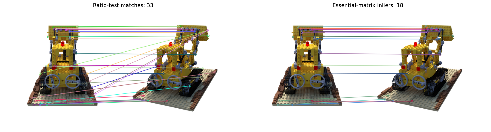

# Overview

Hands-on experiments with computer vision concepts and 3d reconstruction.

## Project Setup

First-time setup after cloning. Requires Linux x86_64, an NVIDIA GPU with a CUDA 12.9+ driver (developed on a GTX 1660 Ti, sm_75), `git` and `curl`/`wget`.

1. Install pixi
```bash
wget -qO- https://pixi.sh/install.sh | sh
```
Restart the shell, then check `pixi --version`.

2. Clone with submodules (OpenMVS and VCG live in `third_party/`)
```bash
git clone --recurse-submodules https://github.com/aby03/3d-reconstruction.git
cd 3d-reconstruction
# if you already cloned without --recurse-submodules:
git submodule update --init --recursive
```

3. Install the main environment
```bash
pixi install
```

4. Build OpenMVS with CUDA (one-off, takes several minutes)
```bash
pixi install -e build
pixi run -e build openmvs
```
Binaries are installed to `.local/openmvs/bin/OpenMVS/` and are added to `PATH` by pixi. Details and troubleshooting: [OpenMVS CUDA build](plans/architecture/openmvs_cuda_build.md).

5. Verify the OpenMVS build
```bash
pixi run DensifyPointCloud --help      # should print "--cuda-device"
pixi run -e build ldd .local/openmvs/bin/OpenMVS/DensifyPointCloud | grep -Ei 'cuda|not found'
```

6. Download data
```bash
pixi run download-data
```

## Running 3d reconstruction pipeline

The pipeline is run through the `recon` pixi task. Use the ~5 s test clip `data/room2_tiny` for quick sanity checks: every step runs in seconds on it, while the full `data/room2` capture gets expensive from SfM onward. Create the clip once with `pixi run make-test-clip`.

```bash
pixi run recon --help
pixi run recon run --help
pixi run recon list-stages     # stages in pipeline order, with their directories and config sections
```

### Run the pipeline
```bash
pixi run recon run --input data/room2_tiny                     # every stage (now: ingest, keyframes, sfm)
pixi run recon run --input data/room2_tiny --to keyframes      # stop after a stage
pixi run recon run --input data/room2_tiny --set keyframes.method=uniform
```
Per-sequence stages (ingest, keyframes) write to `outputs/<scene>/sequences/<sequence_id>/<NN_stage>/` (here `outputs/room2_tiny/sequences/room2_tiny_20261021_211400/`); scene stages (sfm and later), which combine every sequence of a run, write to the run dir `outputs/<scene>/runs/<run_id>/<NN_stage>/`. A stage whose result is up to date (finished successfully with the same config section and the same upstream results, and every artifact still there) is skipped, so a second run takes about a second and changing a `keyframes.*` key re-runs only keyframes. Each invocation leaves a record in `outputs/<scene>/runs/<run_id>/`: `run_manifest.json` (status of every stage: `success`, `skipped`, `failed`), `config.resolved.yaml` (the merged config) and `logs/pipeline.log`. Every `recon run` starts a new run dir, so its scene stages run again; `--resume` continues in an existing run dir instead and skips its up-to-date scene stages:
```bash
pixi run recon run --input data/room2_tiny --resume                    # the latest run
pixi run recon run --input data/room2_tiny --resume 20261031_025715    # a given run id
```

| Option | Meaning |
|---|---|
| `--input DIR` | capture folder (or its stamp folder) |
| `--scene NAME` | scene name, defaults to the capture folder name |
| `--output-root DIR` | same as `--set run.output_root=DIR`, defaults to `outputs` |
| `--from STAGE` / `--to STAGE` | first / last stage to run |
| `--only STAGE` | run just this stage; its upstream stages must already be done |
| `--force STAGE` | re-run this stage and every stage after it |
| `--resume [RUN_ID]` | continue in that run dir (no id: the latest run) instead of a new one; it must be a run of the same capture |
| `--config FILE` | YAML file layered on `configs/default.yaml` (repeatable) |
| `--set KEY=VALUE` | override one key, value parsed as YAML (repeatable), e.g. `--set ingest.gravity_method=lowpass` |
| `--gravity-method`, `--time-offset-ns`, `--no-verify-refs` | shortcuts for `ingest.gravity_method`, `ingest.camera_time_offset_ns`, `loader.verify_reference_jpegs=false` |

**Config.** `configs/default.yaml` lists every key with its default: `run`, `device` and one section per step (`loader`, `ingest`, `keyframes`, `sfm`). Unknown keys and wrong types are errors that name the full key path.

**GPU.** `device.preference: auto` (default) runs an operation on CUDA where this machine supports it and falls back to the CPU with a warning; `cuda` makes a missing CUDA path an error, `cpu` forces the CPU (`--set device.preference=cpu`). Per operation: `loader.decode_backend` (`nvdec`/`pyav`) and `keyframes.metrics_backend` (`torch`/`numpy`); SfM (features, matching, mapping) follows `device.preference`. Each stage manifest records the backends it used under `backends`.

### Check the machine
```bash
pixi run recon doctor        # GPU, which operations can use CUDA, versions of Python packages and tools
```

### Inspect a capture (writes nothing)
Loads the capture, checks frame timing, sensor streams and reference JPEGs, syncs the sensors to the frames and prints a summary.
```bash
pixi run recon inspect --input data/room2_tiny
```
Takes `--config`, `--set` and the capture shortcuts (`--gravity-method`, `--time-offset-ns`, `--no-verify-refs`).

### Step 1: ingest
```bash
pixi run recon ingest --input data/room2_tiny
```
Same as `recon run --only ingest`, with the same options except `--from/--to/--only`; `--force` re-runs it even if it is up to date. Writes `outputs/room2_tiny/sequences/room2_tiny_20261021_211400/01_ingest/`.

Results to look at:
```bash
D=outputs/room2_tiny/sequences/room2_tiny_20261021_211400/01_ingest
cat $D/stage_manifest.json $D/reports/sync_report.json
head $D/frames.csv $D/sync/frame_sensor_data.csv
ls $D/reports/plots/        # timeline, sensor_rates, gravity, omega
```

### Step 2: keyframes
Needs a finished ingest of the same capture (`recon ingest` first, or use `recon run`).
```bash
pixi run recon keyframes --input data/room2_tiny
pixi run recon keyframes --input data/room2_tiny --set keyframes.method=uniform --uniform-fps 2   # uniform baseline
```
Same as `recon run --only keyframes`. Scores every frame for blur, exposure, texture and rotation speed (`frame_scores.csv`), rejects bad frames and picks keyframes: by default (`keyframes.method=adaptive`) a new keyframe is taken when the image has moved enough since the last one (KLT flow, lost tracks) or the gyro has turned 8°, with the thresholds tuned so there are 2.5–7 keyframes per second and never a gap above 1 s; `--set keyframes.method=uniform` instead picks the best frame around each 1/`uniform_fps` tick. It writes the keyframes as full-resolution upright JPEGs, and writes per-keyframe IMU priors (gravity in the camera frame, gyro rotations between nearby keyframes) to `.../room2_tiny_20261021_211400/02_keyframes/`. `--force` re-runs it even if it is up to date. Reject thresholds and score weights are `keyframes.reject.*` and `keyframes.weights.*`.

Results to look at:
```bash
D=outputs/room2_tiny/sequences/room2_tiny_20261021_211400/02_keyframes
cat $D/stage_manifest.json $D/reports/selection_report.json
head $D/keyframes.csv $D/frame_scores.csv $D/priors/gravity_cam.csv $D/priors/relative_rotations.csv
ls $D/images/cam0/          # <frame idx>.jpg
ls $D/reports/plots/        # scores_timeline.png (scores, flow, tracks; keyframes in red), keyframe_strip.jpg
```

### Step 3: sfm
Needs finished keyframes (`recon keyframes` first, or use `recon run`).
```bash
pixi run recon sfm --input data/room2_tiny
pixi run recon sfm --input data/room2_tiny --set sfm.matching.strategy=sequential --force
```
Same as `recon run --only sfm --resume`: it continues in the latest run of the scene (or starts a new run when there is none), so a finished SfM is kept; `--resume RUN_ID` picks another run and `--force` re-runs it. It extracts SIFT features of every keyframe (GPU), matches them (`sfm.matching.strategy`: `auto` matches every pair up to 200 keyframes and each keyframe with its 20 successors beyond that) and runs COLMAP's global mapper. The IMU helps: each keyframe's gravity direction (`priors/gravity_cam.csv`) is written into the COLMAP database as a pose prior and constrains rotation averaging (`sfm.priors.use_gravity_prior`; the model's +y then points down), and before mapping every verified image pair whose relative rotation disagrees with the gyro by more than 10° (pairs over 5 s apart: whose rotation doesn't carry one image's gravity onto the other's within 5°) is removed (`sfm.priors.imu_pair_filter.*`; if more than 30% disagree, nothing is removed and a warning is logged). The result is one COLMAP model with a `SIMPLE_RADIAL` camera per sequence, written to `outputs/room2_tiny/runs/<run_id>/03_sfm/`. COLMAP's own log goes to `runs/<run_id>/logs/sfm/colmap.log.<timestamp>`. Keys: `sfm.initial_camera_model`, `sfm.features.*` (`max_num_features`, `max_image_size`, `domain_size_pooling`), `sfm.matching.*` (`strategy`, `exhaustive_max_images`, `overlap`, `quadratic_overlap`, `min_num_inliers`, `max_num_matches`), `sfm.priors.*` (`use_gravity_prior`, `gravity_min_conf`, `imu_pair_filter.{enabled, max_rot_err_deg, max_dt_s, tilt_err_deg, max_removed_frac}`), `sfm.mapper.backend`. Without the IMU:
```bash
pixi run recon sfm --input data/room2_tiny --force --set sfm.priors.use_gravity_prior=false --set sfm.priors.imu_pair_filter.enabled=false
```

Results to look at:
```bash
D=$(ls -d outputs/room2_tiny/runs/*/03_sfm | tail -1)
cat $D/stage_manifest.json $D/reports/sfm_report.json $D/intrinsics.json
ls $D/sparse/raw $D/reports/plots/   # COLMAP model; track_len_hist, reproj_hist, trajectory_topdown
pixi run colmap gui --database_path $D/database.db --image_path $D/images --import_path $D/sparse/raw
```
`reports/pair_filter.csv` lists every verified pair with its check (`gyro`, `tilt`, `none`), angle error and whether it was removed; `gravity_spread_deg` in the report is how far the registered cameras' gravity directions spread around their mean in the model (small = model and IMU agree). `sparse_points.ply` holds the coloured sparse points; `images/` holds one symlink per sequence to its keyframe images (the COLMAP image root).

### Tests
```bash
pixi run test               # runs every step's test on data/room2_tiny
```


## Running tutorials

### 1a. projection
Project 3d world coordinates to image plane given intrinsics and extrinsics
```
pixi run 1a_projection
```


### 1b. Epipolar Geometry
Covers Essential Matrix, Fundamental Matrix and Epipolar line computation given 2 views sharing world coordinates frame.
```
pixi run 1b_epipolar
```


### 1c. Multi-view Geometry
Using 2 images, compute matching points, essential matrix, relative pose, camera positions and matching points projection in 3D.
```
pixi run 1c_two_view_geometry
```




### 3. Room Reconstruction
Compare two room reconstruction pipelines. The `3a` baseline uses COLMAP for sparse-to-dense reconstruction. The `3b` pipeline samples the `room2` MP4 with OpenCV, estimates camera poses with COLMAP, and uses OpenMVS for dense reconstruction and image texturing.

```bash
pixi run 3a_reconstruction
pixi run 3b_reconstruction
```

The `3b` pipeline defaults to `data/room2` and writes timestamped runs under `outputs/room2_reconstruction/`. OpenMVS must be built first (setup step 4); the pipeline finds its tools on `PATH`. See the [reconstruction guide](src/tutorials/3_reconstruction/README.md) for details.